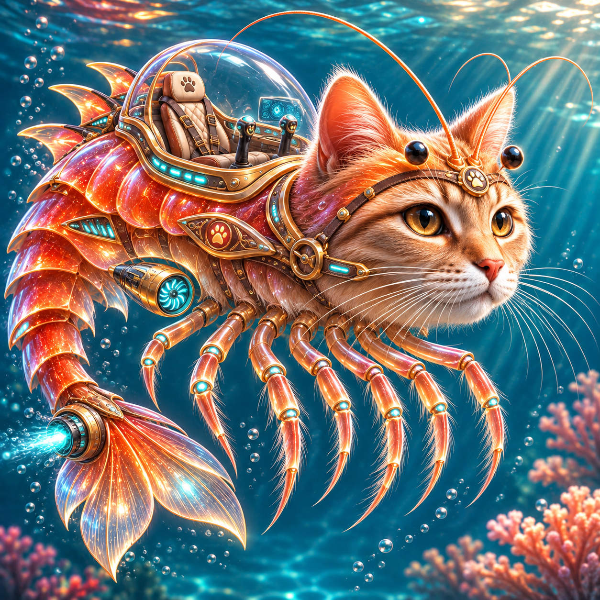

# Подкотини Креветини

Практическая работа №1 «Безумное средство передвижения».

Автор ТЗ и тестов: Мельников Данил Витальевич, БСБО-16-23, №11. Стихия: вода.



«Подкотини Креветини» — биомеханический подводный транспорт с герметичной кабиной, хвостовым водомётом и плавательными конечностями. Модель описывает движение, изменение глубины, энергию, повреждения и преодоление препятствий.

## Файлы

- `SPEC.md` — техническое задание (версия 0.9.3).
- `podkotini_krevetini.py` — класс транспорта и доменные исключения.
- `BUGREPORT.md` — результаты проверки и вопросы разработчика.
- `REFLECTION_Tsygankov.md` — рефлексия по проверке и интеграции реализации.
- `TEST_CASES.md` — 40 тест-кейсов: 32 модульных, 8 сценарных.
- `tests/` — тесты на `unittest` и тестовая обёртка пилота.
- `RESPONSES.md` — ответы автора на замечания ревьюеров.
- `CHANGELOG.md` — изменения ТЗ и тестов.
- `assets/` — иллюстрация транспорта.

## Тесты

Python 3.10+. Сторонние библиотеки не требуются.

```bash
python3 -m unittest discover -s tests -v
```

## Реализация

Класс `PodkotiniKrevetini` поддерживает движение в режимах `cruise` и `boost`, погружение и всплытие, зарядку, повреждение и ремонт. Публичные свойства доступны только для чтения; ошибки не изменяют состояние.

```python
from podkotini_krevetini import PodkotiniKrevetini

craft = PodkotiniKrevetini("Креветини", 250, 1.8, 40, 200)
craft.dive(20)              # расход 2, энергия 98
craft.move(10)              # 0.25 ч, энергия 78
craft.surface()             # расход 1, энергия 77
print(craft.get_status())
```
