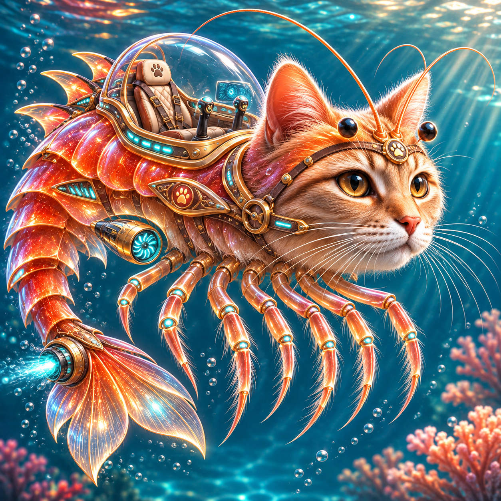

# ТЗ: «Подкотини Креветини»

- **Автор:** Мельников Данил Витальевич (№ 11, БСБО-16-23)
- **Стихия:** вода
- **Проект:** Podkotini-Krevetini
- **Репозиторий:** https://github.com/FullWho/Podkotini-Krevetini
- **Версия:** 0.9.3

## 1. Назначение

«Подкотини Креветини» — одноместный биомеханический подводный транспорт в форме кота-креветки. Герметичная кабина защищает пилота, сегментированный хвост с реактивным соплом создаёт тягу, а плавательные конечности обеспечивают маневрирование. Программная модель описывает перемещение по воде, изменение глубины, расход и восполнение энергии, повреждения корпуса и проходимость препятствий.



## 2. Стихия и обязательный конструкционный элемент

- **Стихия:** вода. Работа на суше и полёт невозможны.
- **Конструкционный элемент:** хвостовой плавник с водомётным движителем; его размер задаёт `tail_span_m` (м, строго больше 0). Без хвостового движителя движение невозможно. `hull_integrity` — **единый агрегированный показатель исправности корпуса и хвостового привода**: при нуле привод недоступен, а `repair()` восстанавливает оба узла одновременно; отдельная степень исправности двигателя не моделируется.
- **Вспомогательные части:** плавательные ножки для маневрирования и купол герметичной кабины на одного пилота; в программном контракте отдельные действия этих узлов не моделируются.
- **Состояние среды:** `depth_m == 0` — поверхность воды, `depth_m > 0` — подводный режим.

## 3. Публичный интерфейс

### 3.1. Класс и модуль

```python
# podkotini_krevetini.py
class PodkotiniKrevetini:
    ...
```

Класс не использует внешние API, файлы или БД. Все числовые параметры — экземпляры `int` или `float`, включая их подклассы, кроме `bool` (запрещён). Значения `nan`, `inf`, `-inf` для **всех** числовых параметров запрещены: `ValueError`. Целое число, которое невозможно преобразовать в конечный `float` (например, `10**400`), также вызывает `ValueError`, а не `OverflowError`. Иные типы, в том числе строки и `bool`, вызывают `TypeError`. Внешние типы (например, NumPy) не входят в зависимости проекта; если они являются подклассом `int`/`float`, действуют общие правила, в остальных случаях — `TypeError`. Проверка конечности распространяется на промежуточные вычисления стоимости, скорости, времени и итоговой позиции. Неизвестные имена параметров обрабатываются стандартным Python `TypeError`. Публичные свойства доступны только для чтения: присваивание пользователем вызывает `AttributeError`.

### 3.2. Конструктор

```python
def __init__(
    self,
    name: str,
    mass_kg: float,
    tail_span_m: float,
    max_speed_kmh: float,
    max_depth_m: float,
    energy: float = 100.0,
    hull_integrity: float = 100.0,
) -> None:
    ...
```

| Параметр | Тип | Единица | Допустимо | Значение по умолчанию |
|---|---|---|---|---|
| `name` | `str` | — | непустая после `strip()` | нет |
| `mass_kg` | число | кг | `> 0` | нет |
| `tail_span_m` | число | м | `> 0` | нет |
| `max_speed_kmh` | число | км/ч | `> 0` | нет |
| `max_depth_m` | число | м | `> 0` | нет |
| `energy` | число | ед. | `0 <= x <= 100` | 100.0 |
| `hull_integrity` | число | % | `0 <= x <= 100` | 100.0 |

`name` сохраняется без внешних пробелов. Для неверного типа — `TypeError`; для неверного диапазона или пустого имени — `ValueError`. Общая проверка конечности и слишком больших целых значений описана в §3.1. Начальное положение `position_km = 0.0`, глубина `depth_m = 0.0`.

### 3.3. Публичные атрибуты (только чтение)

| Имя | Тип | Ед. | Описание |
|---|---|---|---|
| `name` | str | — | Имя транспорта |
| `mass_kg` | float | кг | Масса |
| `tail_span_m` | float | м | Размах хвостового плавника |
| `max_speed_kmh` | float | км/ч | Номинальная скорость |
| `max_depth_m` | float | м | Конструктивный предел глубины |
| `energy` | float | ед. | Остаток энергии (0–100) |
| `hull_integrity` | float | % | Целостность корпуса (0–100) |
| `position_km` | float | км | Сумма успешно пройденных расстояний |
| `depth_m` | float | м | Текущая глубина |
| `is_submerged` | bool | — | `True` ровно при `depth_m > 0` |

Пользователь не может напрямую менять **все десять** атрибутов обычным присваиванием через точку (`obj.energy = 12` и аналогично). Внутренние поля реализации не входят в контракт. При ошибке операции состояние не меняется; эта гарантия относится ко всем методам.

### 3.4. Методы

#### 3.4.1. `calculate_energy(distance_km: float, speed_mode: str = "cruise") -> float`

Рассчитывает стоимость перемещения, **не меняет** состояние и не проверяет достаточность текущей энергии или целостность корпуса. `distance_km > 0`; `speed_mode` только `"cruise"` или `"boost"` (строго с учётом регистра).

- Стоимость `distance_km * coefficient + depth_surcharge`.
- `coefficient = 2` в `cruise`, `4` в `boost`.
- `depth_surcharge = distance_km` **только** при `depth_m > 100` (строго больше 100).
- Все значения — float без принудительного округления. Если вычисленный расход не является конечным, вызывается `ValueError`, состояние сохраняется. Сравнение вещественных результатов в тестах выполняется с допуском `assertAlmostEqual` (7 знаков после запятой), без округления самих значений в реализации.
- `TypeError` при неверном типе, `ValueError` при неверном значении.

#### 3.4.2. `move(distance_km: float, speed_mode: str = "cruise") -> float`

Перемещает аппарат по воде и возвращает длительность в **часах**. Требует `hull_integrity > 0`. Проверяет аргументы и конечность вычисленного расхода, скорости, времени, итоговой позиции; затем целостность, затем запас энергии. В частности, при `hull_integrity=0` и `energy=0` для корректного хода первым будет `PodkotiniImmobilized`. Если энергии меньше стоимости операции, вызывает `PodkotiniNoEnergy`; если целостность равна 0 — `PodkotiniImmobilized`.

- Скорость `cruise = max_speed_kmh`, `boost = max_speed_kmh * 1.5`.
- Время `distance_km / speed`. Если вычисленная скорость, время или новая позиция не конечны либо скорость неположительна, вызывается `ValueError` до изменения состояния.
- После успешного вызова `position_km += distance_km`, `energy -= calculate_energy(...)`.
- Глубина и целостность не меняются; движение разрешено и на поверхности, и под водой.
- Расход ровно в остаток энергии разрешён: если стоимость равна энергии, запас становится 0. Это правило действует также для `dive()` и `surface()`.

#### 3.4.3. `dive(target_depth_m: float) -> float`

Меняет абсолютную глубину погружения. `target_depth_m >= 0`; не может быть больше `max_depth_m` — `PodkotiniTooDeep`. Возвращает фактический расход энергии, равный `abs(target_depth_m - depth_m) * 0.1`. При целостности 0 — `PodkotiniImmobilized`; при недостатке энергии — `PodkotiniNoEnergy`. Если глубина равна текущей, расход 0 и операция допустима, если целостность положительная. Проверки: тип/диапазон, предел, целостность, энергия. Меняет только `depth_m` и `energy`. Вызов `dive(0)` с ненулевой глубины — **управляемая смена глубины**, поэтому его цена `0.1` ед/м, в отличие от `surface()`. Вызов `dive()` на текущую глубину при положительной целостности — допустимая операция с нулевым расходом. Ровно `max_depth_m` разрешено; выше предела — `PodkotiniTooDeep` даже при нулевом корпусе. При сравнении расхода энергии с остатком используется условие `cost > energy`, поэтому точное равенство допустимо.

#### 3.4.4. `surface() -> float`

Поднимается на поверхность (`depth_m = 0`), возвращает расход `old_depth_m * 0.05`. Если уже на поверхности — возвращает `0.0`, не меняя ничего даже при повреждённом корпусе. Иначе при целостности 0 — `PodkotiniImmobilized`; при недостатке энергии — `PodkotiniNoEnergy`. Меняет только глубину и энергию. `surface()` — отдельный экономичный режим всплытия (`0.05` ед/м); это намеренно не синоним `dive(0)`. При полном разрушении на глубине всплытие запрещено. Расход, равный точно всему остатку энергии, разрешён.

#### 3.4.5. `can_overcome(obstacle: str) -> bool`

Проверка без расхода энергии и без изменения состояния. Только препятствия (с учётом регистра) `"reef"`, `"current"`, `"narrow_passage"`, `"surface_net"`:

| Препятствие | Условие преодоления |
|---|---|
| `reef` | `depth_m >= 20` |
| `current` | `energy >= 30` |
| `narrow_passage` | `tail_span_m <= 2` |
| `surface_net` | `depth_m >= 10` |

Если `hull_integrity == 0`, возвращает `False` при любом допустимом препятствии. Неверный тип — `TypeError`, неизвестное значение — `ValueError`.

#### 3.4.6. `recharge(amount: float) -> None`

Требует `amount > 0`, увеличивает запас энергии до предела `100`: `min(100, energy + amount)`. Достижение максимума 100 (насыщение) не является ошибкой только при положительном **конечном** аргументе. Переполнение суммы допустимых конечных чисел при насыщении также трактуется как 100; входные `inf` и `nan` запрещены. Глубина не ограничивает зарядку (модельный сервис). Неверный тип — `TypeError`, число вне допустимого диапазона — `ValueError`.

#### 3.4.7. `damage(amount: float) -> None`

Требует конечное `amount > 0`, уменьшает целостность до минимума `0`: `max(0, hull_integrity - amount)`. Неверный тип — `TypeError`, значение — `ValueError`. При нуле целостности невозможны `move`, `dive`, а также `surface` при ненулевой глубине.

#### 3.4.8. `repair(amount: float) -> None`

Требует конечное `amount > 0`, повышает целостность до 100: `min(100, hull_integrity + amount)`. При нулевой целостности ремонт разрешён. Типы и ошибки — как у `damage`.

#### 3.4.9. `get_status() -> dict`

Возвращает **новый** словарь со следующими ключами (и только ими): `name`, `energy`, `hull_integrity`, `position_km`, `depth_m`, `is_submerged`, `tail_span_m`. Значения совпадают с атрибутами на момент вызова. Модификация словаря не изменяет объект.

## 4. Сценарии и тесты

### 4.1. Модульные сценарии (паттерн AAA)

**U1 — Обычный ход:** дано `energy=100`, `max_speed_kmh=40`; `move(10, 'cruise')` возвращает `0.25`, позиция 10, энергия 80.

**U2 — Ускорение:** при `energy=100`, `max_speed_kmh=40`; `move(5, 'boost')` возвращает `5/60`, энергия 80.

**U3 — Выход за предел глубины:** при `max_depth_m=200`; `dive(201)` вызывает `PodkotiniTooDeep`, состояние не меняется.

**U4 — Ремонт после отказа:** `damage(100)`, затем `move(1)` вызывает `PodkotiniImmobilized`; `repair(10)` восстанавливает возможность движения.

### 4.2. Функциональные сценарии (GWT, через пилота)

**S1 — «Коралловый лабиринт».**

- **Given:** энергия 100, скорость 40, предел глубины 200, размах хвоста 1.8, аппарат на поверхности.
- **When:** пилот погружается на 20 м. **Then:** энергия 98, препятствие `reef` преодолимо.
- **When:** пилот проходит 10 км на `cruise`. **Then:** позиция 10, энергия 78, время 0.25 ч.
- **When:** пилот проходит 5 км на `boost`. **Then:** позиция 15, энергия 58, время 1/12 ч.
- **When:** пилот всплывает. **Then:** глубина 0, энергия 57, `is_submerged=False`.

**S2 — «Глубоководный рывок».**

- **Given:** энергия 100, скорость 40, предел глубины 200.
- **When:** пилот погружается на 120 м. **Then:** энергия 88, глубина 120.
- **When:** пилот проходит 10 км на `cruise`. **Then:** расход 30, энергия 58, позиция 10.
- **When:** пилот пытается погрузиться на 201 м. **Then:** `PodkotiniTooDeep`, глубина и энергия неизменны.
- **When:** пилот всплывает. **Then:** энергия 52, глубина 0, позиция 10.

**S3 — «Повреждение у рифа».**

- **Given:** энергия 100, корпус 100, аппарат на поверхности.
- **When:** пилот проходит 4 км. **Then:** энергия 92, позиция 4.
- **When:** корпус получает 100 урона. **Then:** целостность 0.
- **When:** пилот пытается пройти ещё 1 км. **Then:** `PodkotiniImmobilized`, позиция и энергия прежние.
- **When:** пилот выполняет ремонт на 25 и проходит 1 км. **Then:** целостность 25, энергия 90, позиция 5.

**S4 — «Возвращение из глубины».**

- **Given:** энергия 25, глубина 0, предел 200, скорость 40.
- **When:** пилот погружается на 100 м. **Then:** энергия 15.
- **When:** пилот пытается пройти 10 км на `boost`. **Then:** `PodkotiniNoEnergy`, позиция остаётся 0.
- **When:** пилот всплывает. **Then:** энергия 10, глубина 0.
- **When:** пилот заряжает 30 и проходит 5 км на `cruise`. **Then:** энергия 30, позиция 5.

Тест-кейсы имеют стабильные идентификаторы `TC-01`…`TC-40` в [`TEST_CASES.md`](TEST_CASES.md). Тестовый класс сценариев использует обёртку `Pilot`, предоставляющую команды предметной области; требования к классу транспорта при этом не расширяются.

### 4.3. Test Case Specification

Полная таблица с предусловием, входом, ожиданием и приоритетом — отдельный файл [`TEST_CASES.md`](TEST_CASES.md). Соотношение: 32 модульных (80%) и 8 сценарных (20%). Каждый тест содержит ID в имени и docstring.

## 5. Граничные случаи

1. Погружение на `depth=100`: надбавки к расходу движения **нет**; на `depth > 100` — есть.
2. `move(50, 'cruise')` с `energy=100` расходует ровно 100 и успешно завершается.
3. `surface()` на глубине 0 возвращает 0, даже когда целостность 0.
4. `recharge(1000)` и `repair(1000)` ограничиваются сверху 100.
5. Отрицательное/нулевое расстояние и `nan` запрещены.
6. Переполнение результата вычисления расхода, скорости, времени или новой позиции запрещено (`ValueError`).
7. `dive(0)` и `surface()` с глубины 20 м имеют разные расходы: 2 и 1 единицу.
8. Все параметры каждого метода проходят проверку типов, конечности и границ.
9. При полностью разрушенном корпусе `can_overcome` возвращает `False` для каждого допустимого препятствия.
10. Значения ровно на порогах (20 м, 10 м, 30 ед., 2 м, max_depth_m) допустимы.

## 6. Исключения и иерархия

```text
Exception
└── PodkotiniError
    ├── PodkotiniNoEnergy
    ├── PodkotiniTooDeep
    └── PodkotiniImmobilized
```

Все доменные исключения наследуются от `PodkotiniError`, который наследуется от `Exception` (не от `RuntimeError`). Сообщения детально не контрактуются, кроме возможности прочитать строку ошибки. Состояние при любом исключении остаётся прежним.

| Ситуация | Исключение |
|---|---|
| Неверный тип параметра (`bool` для числа включительно) | `TypeError` |
| Некорректное числовое значение, неизвестный режим/препятствие | `ValueError` |
| Недостаточно энергии для движения/погружения/всплытия | `PodkotiniNoEnergy` |
| Целевая глубина больше `max_depth_m` | `PodkotiniTooDeep` |
| Нулевая целостность при попытке двигаться/погружаться/всплывать с глубины | `PodkotiniImmobilized` |

## 7. Что вне рамок

Нет движения по суше и полёта, пассажирских мест кроме одного, управления скоростью ветра/течениями, визуального интерфейса, хранения данных, внешних датчиков, файлов/HTTP API, сетевой синхронизации и взаимодействия с другими объектами. Состояние не сохраняется между запусками. `mass_kg` сохраняется как характеристика аппарата и в текущей модели не влияет на расчёты или сравнение экземпляров. Концепт-арт в README — **статическая иллюстрация**; исполняемая графика, анимация и GUI не входят в проект.

## 8. Трассируемость «требование → тест»

| Требование | Раздел ТЗ | Тест-кейсы |
|---|---|---|
| Валидация конструктора: типы, диапазоны, конечность, trim | 3.1–3.2 | TC-01…TC-09 |
| Десять атрибутов только для чтения | 3.3 | TC-10 |
| Расчёт энергии, глубинная надбавка, неверные аргументы и переполнение | 3.4.1 | TC-11…TC-14 |
| Движение: скорость, расход, ошибки, порядок проверок, атомарность | 3.4.2 | TC-15…TC-17, TC-30, TC-33…TC-40 |
| Погружение: расход, предел, неверные значения, нехватка энергии, корпус | 3.4.3 | TC-18…TC-20, TC-33, TC-35…TC-36 |
| Всплытие: стоимость, полный расход, пустая операция, повреждения | 3.4.4 | TC-21…TC-22, TC-33, TC-35, TC-40 |
| Препятствия: виды, границы, валидация, корпус | 3.4.5 | TC-23…TC-26, TC-33 |
| Заряд, повреждение и ремонт: ограничения, ошибки значений и типов | 3.4.6–3.4.8 | TC-27…TC-29, TC-37…TC-40 |
| Статус и независимость копии | 3.4.9 | TC-31…TC-32 |
| Иерархия исключений и атомарность | 6 | TC-17, TC-19…TC-22, TC-30, TC-32, TC-35…TC-40 |
| Сценарии S1–S4 | 4.2 | TC-33…TC-40 |

Все 40 методов тестирования содержат уникальный ID в имени и docstring. Сочетания эквивалентных входов проверяются с `subTest`, без увеличения количества тест-кейсов. После согласования ревью ТЗ можно заморозить.

## 9. Открытые вопросы

Блокирующих вопросов по поведению интерфейса после рассмотрения ревью нет. Для заморозки требуется согласование изменения тестового набора и согласование ответов в `RESPONSES.md`. Выбор порога глубинной надбавки (100 м), объединённой исправности корпуса и хвостового привода и различия между `dive(0)` и `surface()` является частью указанного контракта.
